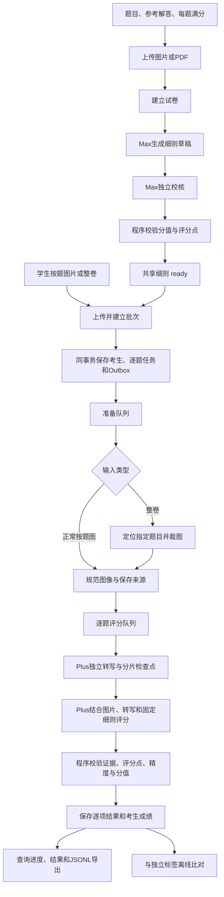

# 技术工作流与实现状态

当前实现是一个全自动的主观题评分工作流：接入材料，准备共享细则，持久化批次，按考生和题目并发执行，验证证据与分值，保存和导出结果，最后独立评估分数质量。没有教师审核步骤。当前开发配置针对正常朝向、内容完整的输入，采用B组合，并为评分启用思考。

实现以API、队列和持久化状态为核心。现有简易工作台只消费这些接口；后端功能不依赖浏览器。此次收尾按用户要求聚焦技术链路，不继续扩展前端。

## 端到端流程



B配置默认不对学生作答执行Max复判；其他批次可显式选择全部复判或风险触发复判。复判会重新独立转写和判断，不接收初评分数。图中任一阶段发生协议、输入或校验错误都会保存失败状态，不生成默认成绩。

| 阶段 | 接口或执行入口 | 持久化产物 | 当前状态 |
| --- | --- | --- | --- |
| 材料接入 | `POST /v1/assets` | 有序图片资产ID；PDF逐页展开 | 已实现并测试 |
| 细则准备 | `POST /v1/exams` → `prepare_exam` | 固定题目、满分、评分点、规则、替代解法及修正记录 | 已有真实百炼闭环 |
| 建立批次 | `POST /v1/jobs` | 模型配置快照、考生、逐题Answer、Outbox | 已验证1000人创建5000题；支持选题 |
| 输入准备 | `prepare_candidate` | 原图与处理图映射、页序、检测框及裁图框 | 两类输入已实现；当前正常按题图跳过方向模型 |
| 独立转写 | `grade_answer` 中的转写阶段 | 行ID、文字、来源图片、清晰度、涂改和问题标记 | 已有单图、双图与长输出实测 |
| 评分 | `grade_answer` 中的评分阶段 | 每个评分点的分数、理由、证据ID | Plus评分思考已在真实响应确认生效 |
| 结果校验 | `finalize_grade` | `scored` / `ungradable` / `failed` | 已实现结构与业务校验 |
| 查询与导出 | `GET /v1/jobs/{id}`、`/results`、`/export` | 进度、分页成绩、逐项结果、JSONL | 已有真实HTTP验证 |
| 质量评估 | CLI `evaluate`、`GET /v1/jobs/{id}/evaluation` | 覆盖率、全量±1分比例、MAE、失败数 | 已实现；当前分数质量未通过验收 |

## 两种输入与选题契约

试卷先提交每道题的`id`、题干文字或`question_assets`、参考文字或`reference_assets`和`max_score`。`GET /v1/exams/{id}`返回`ready`后，后续批次复用细则。新建批次默认覆盖所有主观题；顶层`question_ids`可明确选择子集，不重新复制试卷或重置共享预算。

按题输入示例：

```json
{
  "exam_id": "existing-ready-exam-id",
  "question_ids": ["17"],
  "strategy": "B",
  "budget_cny": "0.50",
  "candidates": [
    {
      "candidate_id": "candidate-001",
      "kind": "question",
      "answers": [{"question_id": "17", "assets": ["answer-image-id"]}]
    }
  ]
}
```

整卷输入将考生对象换成`{"candidate_id":"candidate-001","kind":"paper","pages":["page-1-id","page-2-id"]}`。同一人的页图按阅读顺序排列，定位模型只请求所选题号。按题输入必须完整覆盖所选题目，重复、未知、遗漏题号在提交时直接拒绝。一个题目允许多张图片。

`Idempotency-Key`保护批次创建：相同键与相同内容返回原批次，内容冲突返回409。未设置`question_ids`的旧全卷请求保持原指纹兼容。HTTP提交返回202和批次ID，不等待模型执行。

## 模型实际接收什么

| 模型阶段 | 输入 | 隔离边界 |
| --- | --- | --- |
| 细则草稿与校核 | 题目、参考解答及相应图片、满分与给分精度 | 不接收学生分数或作答 |
| 方向与定位 | 处理后的页面图片、指定题号；按题方向步骤可关闭 | 不根据参考分调整裁切 |
| 转写 | 学生作答图片、忠实转写指令和结构定义 | 不接收参考答案、细则或学生分数 |
| 主评分 | 学生作答图片、题目图片、题目文字、固定细则、转写和精度 | 不接收原有成绩标签 |
| 独立复判（可选） | 重新转写后的同类材料 | 不提供初评分数 |
| 离线评估 | 已保存结果与独立参考分 | 不再调用模型 |

图像通过百炼兼容接口的图像消息传输。上传阶段会处理透明背景、PDF展开和图像规范化；调用阶段控制每张图片像素数。这些步骤统一输入协议，不代表识别或数学判断一定正确。

## 长题与context

当前转写按自然图片分片，默认每次1张、每题最多2个转写请求并行；合并后按片号给证据ID加前缀，保持来源映射。每个成功分片立即保存检查点，一片失败时先等待已发出的付费请求结束，保存成功结果，再结束该评分单元。显式重试可复用成功分片。

转写输出上限为8192 Token，评分为4096；评分的思考内容也占供应商输出预算。请求发出前保守估算输入，当前配置上限250000 Token。超限或输出截断会明确失败，保留审计，不截掉后半段继续给分。

自然图片分片只缩短单次转写；最终整题评分仍需容纳合并后的转写和相关图片。超长整题的分层评分与聚合尚未实现。当前已实测原4096输出截断样例在8192上限下完整转写，不能据此保证任意长度题目均可处理。

## 并发与稳定性

运行单元分别为考生输入准备和逐题评分，不按1000名考生串行循环。当前本机有4个准备线程、32个评分线程、1个调度线程及Beat；Redis按模型限制最多16个在途请求，并约束RPM和TPM。多个Worker共用限额，同一道题保留“先转写、后评分”的数据依赖。

PostgreSQL保存状态与Outbox，批次和待发送消息在同一事务写入。控制队列将Outbox发往业务队列，成功发送后删除；重复投递由数据库执行状态和令牌约束。容量不足时通过带执行时间的Outbox重新排队，任务不占着线程等待模型额度。

Worker领取单元后写入租约和执行令牌；心跳续租，过期单元由调度恢复。检查点和最终写入验证令牌，过期Worker不能覆盖新结果。模型响应成功缓存与阶段检查点减少重复工作；供应商超时后的真实执行和计费无法保证恰好一次。

| 对象 | 主要状态 | 终止与恢复方式 |
| --- | --- | --- |
| 试卷 | `queued → running → ready`，错误为`failed` | 显式试卷重试，复用通过校验的细则 |
| 考生准备 | `queued → running → ready`，错误为`failed` | 页级检查点；缺题时显式重新定位 |
| 单题 | `waiting → queued → running → scored/ungradable/failed` | 自动恢复失效租约；请求错误通过重试接口显式重试 |
| 批次查询 | `queued/running/completed/completed_with_errors` | 按真实逐题状态聚合；失败仍计入完成数和评测分母 |

## 评分结果与费用

`scored`只说明流程完成且通过程序校验，不能等同于数学评分正确。`ungradable`保留空分项或总分；`failed`保留执行错误。确认真正空白的作答可以是0分，缺图、协议失败或看不清不能替代成0分。

每题保存`grade`、`transcript`、`verified`、`primary_grade`、`rubric_version`和`prompt_version`，每个评分点包含`criterion_id`、分数、理由和证据ID。正分必须引用存在且清楚的学生证据，划掉或不清楚的行不能用于确定给分。程序使用Decimal检查上限、精度和总分。

模型调用分别记录角色、模型、请求指纹、响应、usage、状态、费用与时间。试卷总预算覆盖细则和所有批次，批次预算进一步限制本批；并发调用先在数据库锁内预留，两级预算通过后才请求模型，返回usage后结算。用量未知的调用保留预留，不重新释放为可花余额。

查询中的`input_tokens`和`output_tokens`是已记录用量之和，`unknown_usage_calls`单独记录未返回用量的调用数；`known_cost_cny`是已知费用，`unpriced_or_unknown_calls`记录未计价或费用未知的调用数。两类未知信息分开统计。计费以百炼账单为准。

## 已验证与待完成

2026-11-07的代码检查为286项测试通过，Ruff、编译、JavaScript语法、分发包资源及Compose配置检查通过。真实PostgreSQL/Redis/Celery/API与百炼已跑通。最新单题批次`ce600eaf322741e89574777e21d1425f`通过上传、持久化排队、转写、开启思考的评分、校验、查询、JSONL导出和独立标签比对；两次模型调用均成功，已记录费用0.056022元。

1000人5000题使用模拟模型的真实队列测试和故障恢复已经通过，真实百炼观测到并发16。真实千人端到端吞吐、跨试卷泛化、超长整题分层评分和分数质量达标仍待后续验证。正式155题验收未通过，开启思考的20题开发回归也未证明整体误差改善；详见[验证记录](verification.md)。当前应作为有真实调用和评测依据的工程原型展示。

核心代码：[API](../src/ai4edu/api.py)、[流水线](../src/ai4edu/pipeline.py)、[任务与恢复](../src/ai4edu/tasks.py)、[模型调用与预算](../src/ai4edu/calls.py)、[共享限流](../src/ai4edu/limits.py)、[证据与分数校验](../src/ai4edu/scoring.py)、[离线评估](../src/ai4edu/evaluation.py)。本机启动见[运行手册](functional-runbook.md)。
