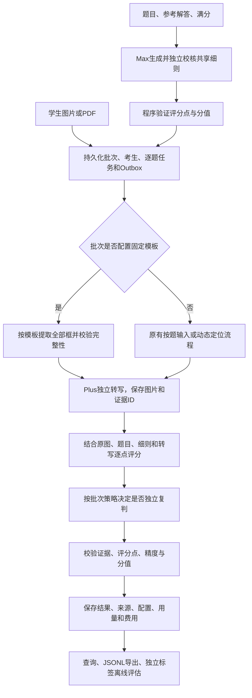

# ai4Edu 项目开发复盘

整理日期：2026-11-08，Asia/Shanghai。代码基准：`eb71fd0`。

本文基于 ai4Edu 工作区4个主会话的导出原文，并用现有代码、机器可读实验报告和验证文档交叉核对。会话快照共182条用户与助手可见消息，讨论覆盖2026-11-07至2026-11-08。本次整理没有执行新的模型实验；文中的测试数和实验数字均注明其原有范围。

聊天原文在本地交付ZIP中单独提供，不上传GitHub。本文指向`data/chat_exports/`的会话链接可在解压后的交付包中打开；GitHub仓库内不包含这些聊天文件。

截至该版本，项目已形成可运行的主观题评分后端：能够接入答卷、生成共享细则、并发转写与判分、保存证据和费用、导出结果并开展离线评测。正式分数质量验收没有通过，固定模板新路径也尚未完成真实百炼评分回归。项目适合以“有真实调用、错误记录和评测依据的AI应用工程原型”展示。

## 1. 项目目标与需求如何收敛

最初目标是批量输入学生手写试卷扫描件，输出学生得分和判卷细则。样例包含50名学生、每人两页答题卡，以及题目、参考解答和成绩表。任务同时涉及手写识别、公式与图形理解、解题过程判断和部分给分。

需求在讨论中逐步确定：

| 约束 | 最终采用的范围 | 对实现的影响 |
| --- | --- | --- |
| 题型 | 先判主观题，客观题后置 | 当前样例聚焦第15—19题，满分分别为13、15、15、17、17，总计77分 |
| 评分细则 | 用户没有进一步的逐步给分标准 | 系统需要从题目、参考解答和满分自动生成、校核统一细则 |
| 人工参与 | 本阶段没有teacher-in-the-loop | 不能把教师复核作为完成流程的必经步骤；无法判断时保留未知分数 |
| 输入形式 | 按题图片和整卷均需支持 | 同时设计作答图片列表、整卷页列表及区域来源映射 |
| 模型服务 | 使用阿里云百炼API | 模型ID、角色、价格和限额显式配置，不自行训练或微调模型 |
| 批量规模 | 一批最多1000名考生 | 使用持久化任务队列，不能在一次HTTP请求中串行处理全部学生 |
| 成本与耗时 | 两者同时考虑 | 设计A/B/C对照、共享细则复用、并发准入及两级预算 |
| 输入泛化 | 最初希望处理旋转等情况，后收窄为正常输入 | 当前优先验证正常朝向、内容完整的作答；旋转等质量保证后置 |
| 展示目标 | AI应用／Agent工程实习项目 | 重点体现编排、数据契约、错误定位、实验和工程取舍；后续不继续优化前端 |
| 答题位置 | 同套试卷的答题框固定，允许同题多框 | 增加试卷模板、框归属、顺序与完整性校验 |

早期方案曾包含教师确认细则和人工复核，这些属于当时的讨论方案。用户明确取消人工环节后，最终实现改为自动生成细则、独立校核和程序验证。人工评分只作为已有的离线参考标签使用。

## 2. 四个会话分别贡献了什么

| 会话 | 在复盘中的用途 | 主要产物或结论 |
| --- | --- | --- |
| [Session 01](../data/chat_exports/2026-11-08/01_01a1b3e6.md) | 需求、开源调研、整体框架与交接条件 | 确认主观题、两种输入、全自动、百炼和千人批量；发现文件名含原有成绩，提出避免标签泄漏 |
| [Session 02](../data/chat_exports/2026-11-08/02_01a1b3ec.md) | 开发环境网络排查 | 对比直连与代理，验证HTTP CONNECT和TLS，完成Codex本机代理配置 |
| [Session 03](../data/chat_exports/2026-11-08/03_01a1b3f7.md) | 模型候选与实验设计 | 从全量Max能力对照，扩展为A/B/C三组，并形成模型评测技术方案 |
| [Session 04](../data/chat_exports/2026-11-08/04_01a1b40c.md) | 实现、真实调用、验收和迭代 | 后端、并发与故障测试、正式质量验收、thinking回归、单题接口和固定答题框逻辑 |

以上是各会话内容的用途概述；应用中的原始标题和全部消息见[导出索引](../data/chat_exports/2026-11-08/README.md)。几个会话在时间上有重叠，不应把会话编号理解为严格串行的开发阶段。

主要演进过程是：需求与数据核查 → 框架和模型方案交接 → 后端实现与真实闭环 → A/B/C初评 → 正式质量验收失败 → 正常输入与thinking回归 → 明确面试交付范围 → 补齐固定答题框契约。

## 3. 技术选型及其理由

### 3.1 从开源调研中借鉴流程与数据结构

初始会话记录了对NeuroMark、GradeOps、ScriptGrader、zhupiAI和GradeLens等项目的调研。主要借鉴点是扫描答卷的批量处理、评分点结构、学生证据、复核和导出。OMRChecker被作为客观题方向的参考，未成为当前主观题主链路。

这些项目的演示不能替代本项目的实测。最终仓库中的服务端围绕自身输入协议、百炼调用、队列、预算和评测工具实现；本复盘没有重新核验外部仓库的当前状态或效果。

### 3.2 服务端与数据处理

下表的选型理由根据最终代码结构和会话中的约束归纳，不代表对所有替代技术都做过正式基准比较。

| 技术 | 承担的职责 | 采用理由与边界 |
| --- | --- | --- |
| Python、FastAPI | 材料上传、试卷和批次提交、进度与结果查询 | 便于接入图像处理和模型接口；HTTP提交后返回批次ID，不等待评分完成 |
| Pydantic | 输入、模型输出及模板结构 | 明确题号、分值、证据和框信息的契约；拒绝未知字段和不合法结构 |
| PostgreSQL、SQLAlchemy | 试卷、任务状态、检查点、结果、Outbox和费用 | 为并发任务提供持久化和事务边界；本机真实环境已运行，SQLite用于显式测试与本地审计 |
| Celery | 输入准备、逐题评分、控制调度和定时恢复 | 按业务单元拆分任务，支持独立扩容；当前模型请求主要为I/O等待，使用线程池 |
| Redis | 队列基础设施及共享模型准入、RPM/TPM限制 | 多个Worker共用限额，避免仅靠单进程信号量控制总调用量 |
| Pillow、OpenCV、PyMuPDF | 透明图处理、裁切、旋转、像素预算及PDF展页 | 在请求模型前统一图像协议，保留可审计的来源关系；不能据此保证识别正确 |
| 本地存储，预留OSS实现 | 原图和处理后图片资产 | 本机服务共享文件目录；跨机器存储有接口实现，但没有宣称OSS生产部署已验收 |
| pytest、fakeredis、独立HTTP模拟模型 | 契约、集成、并发和故障验证 | 验证真实服务链路的执行行为，同时明确模拟响应不等于真实模型能力 |

Paddle方向分类是可选组件，没有成为当前正常输入路径的必需依赖。当前也没有训练独立手写OCR模型。

### 3.3 模型组合的演进

最初讨论先使用Max作为能力对照，随后用户强调成本，形成三组实验。当前保留B作为开发基线。

| 方案 | 学生作答的转写与主评 | 独立复判 | 实验目的 |
| --- | --- | --- | --- |
| A | `qwen3.8-max` | 不额外启用学生复判 | 提供较高成本模型的能力对照 |
| B | `qwen3.7-plus` | 关闭 | 判断较低成本方案的覆盖率、误差和费用 |
| C | `qwen3.7-plus` | 风险触发时由`qwen3.8-max`重新独立转写与评分 | 测试升级路由能否捕获问题，并带来值得付费的改善 |

共享细则的草稿和独立校核由Max承担，准备后供后续批次复用。“B使用Plus”指学生判题阶段，不表示整套系统从未调用Max。

实验时使用的配置参考单价为Plus输入/输出2/8元、Max输入/输出12/36元，单位为每百万Token。它们用于复现历史费用计算，不是本复盘对当前价格或模型规格的重新核验；实际收费以供应商账单为准。

## 4. 最终工作流与关键数据边界

有三个数据边界直接关系到评分可信度：

1. 转写阶段只读学生作答，不接收参考解答和评分细则，减少“根据正确答案补写学生内容”的风险。评分阶段保留原图，避免只依赖丢失二维信息的文字。
2. 评分细则先准备并固定，同一批次不能按每名学生的答案临时改给分标准。每批保存执行配置，结果保留细则哈希和提示词版本。
3. 原有成绩标签独立保存，评分完成后才进行比对，不进入细则、模型输入或自动复判路由。

当前主体是有固定依赖和可配置复判分支的多模态工作流。它具备模型角色、工具接入、状态管理和校验器，但没有自主制定长期计划或任意选择工具，面试介绍时应准确说明这一边界。

## 5. 关键问题与解决过程

### 5.1 没有逐步给分细则，却要求全自动评分

**问题。** 只有题目、参考答案和满分，不足以直接确定每一步给几分；用户又明确要求没有教师审核。若每名学生的评分请求都自行生成标准，给分口径可能发生变化。

**处理。** 将细则构建独立为试卷准备任务：生成评分点草稿，再独立校核，最后用程序检查题号、满分、评分点唯一性、分值总和和给分精度。共享细则准备一次，批次复用。

**仍有的限制。** 数学结论、部分分分配和替代解法覆盖仍由模型生成。结构与加总正确，不代表规则本身合理。共享细则中的系统性错误还可能影响整批学生。

### 5.2 模型可以读图，为什么还需要前处理

**问题。** 图像格式转换本身也可能损失作答信息。调试中发现透明PNG直接转RGB会丢失可见笔迹；整页定位后的边界也可能截断笔画。

**处理。** 透明图先在白色背景上合成，统一EXIF方向和图像格式；PDF逐页渲染，裁图和旋转受像素预算约束。动态定位路径加入基于短边像素的4%边距，并受邻题约束，保存检测框与实际裁图框，便于回溯。

**证据边界。** 像素与几何测试能验证转换、裁切算法的行为；后续真实检查仍观察到边缘内容截断，不能把这些处理写成内容完整性已经验收通过。固定版式因此需要进一步引入显式模板约束。

### 5.3 一道题太长，输出被截断

**问题。** 单题转写超过4096输出Token上限时，响应不能完整结束。把不完整转写继续交给评分，会让缺失内容变成扣分依据。

**处理。** 转写与评分分别配置输出上限，当前开发配置为8192/4096；按自然图片分片转写，每题最多两个分片请求并行。成功分片立即保存，合并时给证据ID加片号前缀，保留来源图片。

某片失败后，先等待已经发出的付费请求结束并保存成功结果，再结束该单元；显式重试能够复用成功分片，避免把同一题的全部请求重新发一遍。

**验证。** 原来发生4096输出截断的同一张图，在8192上限下完整输出4871Token并完成评分；双图转写有实际请求重叠记录。

**剩余问题。** 分片解决的是单次转写长度，最终整题评分仍要接收合并后的转写和图片。超长整题的分层评分与聚合尚未实现；输入预算超限或输出截断时明确失败，不截掉后半部分继续给分。

### 5.4 从“能批量提交”到“能并发、能恢复”

**问题。** 1000名考生、每人5题意味着5000个评分单元。仅增加线程数不能证明请求实际并发，也不能处理重复投递、Worker中断和模型额度不足。

**处理。** 输入准备按考生拆任务，评分按题拆任务；准备、评分和控制队列分离。批次与Outbox在同一数据库事务中保存，由控制队列分发消息。Redis统一控制各模型的在途请求、RPM和TPM。

任务领取后写入租约和执行令牌，检查点与最终写入都验证执行权。过期任务可恢复，旧Worker不能覆盖新执行结果。容量不足通过带执行时间的Outbox延后调度；HTTP或模型错误不会自动无限重试。

按照减少防御性兜底的要求，JSON或业务校验错误明确保留为失败，不自动修复JSON、静默替换模型或补出默认成绩。C方案的独立复判按预设策略触发，失败重试通过显式接口执行。

**验证。** 千人模拟模型测试核对了实际HTTP请求数量、并发峰值和5000条唯一结果；还执行了重复投递、定向故障及Worker强制终止后的自然租约恢复。

**剩余问题。** 供应商超时后可能仍在执行或计费，系统不能保证外部请求恰好执行、计费一次。真实百炼千人吞吐仍未完成实测。

### 5.5 并发调用下，怎样避免预算和未知费用失真

**问题。** 多个任务同时读取“剩余预算”会产生竞争；请求中断、usage缺失或模型未配置单价时，把费用视为零会低估消费。界面也曾把未知Token用量显示为无说明的0。

**处理。** 试卷总预算覆盖共享细则及所有批次，批次预算进一步限制本批。调用前在事务内预留，取得usage后结算；未知用量保留预留。模型、角色、响应、usage、状态和费用分别记录。

已知费用、费用未知调用数、已记录Token和用量未知调用数分别展示。单题演示复用原试卷和预算，不通过复制试卷重新获得可用额度。

**验证。** 同卷两个并发批次的预算故障测试没有越过总预算；未知用量继续保留预留。未知用量显示问题也在独立审查后补上了回归用例。

### 5.6 防止把标签泄漏和成功率当作准确率

**问题。** 原始扫描文件名含与成绩表一致的总分。直接把文件名交给模型会污染评测；只统计成功评分的题目，还会掩盖失败和无法判定。

**处理。** 准备匿名输入和独立标签，去除分数文件名、处理身份区域和元数据。按学生划分调试、初评与留出组；固定模型、细则和输入后，再读取留出分数。

`scored`只表示完成流程并通过结构、证据与分值校验。质量指标另行计算：可判定率、全量题目中成功评分且误差≤1分的比例、可判定题MAE和执行失败数。无法判定、失败及缺失题目保留在全量指标分母中。

**验证与限制。** 正式验收保留了失败结果，没有为改善数字删题、重试或调低门槛。该留出集随后被用于错误分析，已成为回归资料，不能再次称为未见数据。

### 5.7 thinking生效了，整体正确率却没有改善

**问题。** 正式验收失败后，用户要求先处理正常输入，再开启thinking。不能仅凭请求参数或模型给出的解释，认定思考生效或准确率提高。

**处理。** 正常按题图显式跳过方向模型，只给评分角色开启4096 Token思考预算，转写仍关闭思考。检查真实响应中的reasoning信息与Token统计，保留首轮失败和显式重试记录。

**结果。** 思考组成功响应确认思考生效，但最终20题MAE和±1分数量与关闭思考组相同。一个将“两个零点”误说成“三个”的评分点回归得到修正，只能证明该项改善，不能代表整题或整批质量达标。

**实验限制。** 两组输入图片哈希相同，但转写独立生成，只有6/20份转写完全一致；关闭思考组还包含方向调用。这不是严格只改变thinking一个因素的实验，费用、时延和分数差异不能全部归因于思考。

### 5.8 能返回多个区域，不等于已收齐全部答题框

**问题。** 用户指出同题可能有多个固定框。原实现允许模型返回同题多个区域，也会全部送去评分，但只检查“是否至少找到一个区域”，无法判断应有三个框是否只找到了两个。

先核对了刚演示的第17题：其（1）（2）共用第二页左侧一个大框，实际输入包含完整大框，没有证据表明那次1分差异由漏第二个框造成。这与通用流程确有缺框风险，是两个需要分开的事实。

**处理。** 新增`answer_template`，记录页尺寸、框ID、大题、小问、固定坐标和顺序。新批次保存模板快照及哈希；整卷按坐标裁取，按题输入用`assets`和`box_ids`逐一对应。缺页、缺框、重复或未知框在提交时拒绝，评分前再核对完整集合和模板版本。

相同像素的多个框仍分配不同处理图片ID，避免空白框因资产去重而混淆来源。归属和阅读顺序传入评分上下文，原图与模板映射保留在结果中。模板更新只影响未来批次，旧结果不被修改。

**验证。** 新增63项schema/helper测试和15项接口/流水线测试，包括第二个框才有答案、跨页续答、相同空白框、缺框检查点、选题、旧指纹兼容和旧表迁移。真实扫描页的本地审计提取出了5个框，没有调用模型。

**当前限制。** 模板要求页面已转正并对齐；归一化坐标支持分辨率变化，宽高比偏差超过2%时明确失败，不自动处理平移、透视或页序错误。当前主库样例试卷仍未启用模板，也没有跑完固定模板到真实百炼评分的回归。

### 5.9 开发环境网络与产品链路分开排查

Session 02对比了Codex服务直连与系统代理：直连超时，代理HTTP CONNECT和TLS验证正常，再按已确认的协议配置本机环境。后续本地API诊断显式使用`trust_env=False`，避免localhost请求受到系统代理干扰。

这部分解决的是开发环境连接，不是手写判分质量问题。正常输入思考实验中的一次评分HTTP400在重试中未复现，其根因尚未确定，不能直接归因于代理或声称已经彻底修复。

## 6. 实验设计与结果

### 6.1 数据与比较口径

样例共有50名学生，当前主观题是每人5题。评测准备按学生固定为5名调试、10名初评、35名留出。留出组中4名曾用于功能测试，正式验收将31名首次运行学生作为主要样本，另外4名单列，不混称为35名全新学生。

A/B/C需要复用同一细则和同一裁图。比较均以原有人工分数为参考，Max也接受评估，不能用Max输出替代真值。已有数据主要提供每题总分，尚不足以验证每个评分步骤是否合理。

### 6.2 初评：10名学生、50题

| 方案 | 可判定题数 | 可判定率 | 各自可判定题MAE | 判题阶段参考费用/元 |
| --- | ---: | ---: | ---: | ---: |
| A：Max转写与主评 | 43/50 | 86% | 1.360 | 10.914576 |
| B：Plus转写与主评 | 46/50 | 92% | 1.457 | 2.037792 |
| C：Plus主评、风险触发Max | 44/50 | 88% | 1.114 | 9.125040 |

各组可判定集合不同，上表MAE不能单独用来断言谁整体更准。在B/C共同可判定的43题上，B的MAE约1.198分，C约1.140分，差约0.058分；C的判题阶段费用约为B的4.48倍。这个范围内的成本、覆盖率和误差折中支持暂选B作为同卷开发基线，不能推出B质量已经达标或C在所有数据上没有价值。

该轮C有30/50题升级到Max，升级率60%。混合方案的成本因此仍然很高；升级规则是否准确捕获了应复判的错误，也需要用独立数据继续评估。

费用列排除了共享细则准备和布局阶段，按配置参考单价统计。完整实验实际支出还包含调试、布局和其他调用；`C_simulated`与实际C也单独保存，不能把复用结果的模拟成本当成真实生产账单。机器报告还明确将选择范围标为`provisional_same_exam`。

来源：[初评机器报告](../data/runs/functional-v2/initial/comparison/report.json)。

### 6.3 正式质量验收：31名首次运行学生、155题

四项门槛在读取该批参考分前确定。验收期间不通过重试、删题或修改门槛改善结果。

| 指标 | 预先确定的要求 | 实测 | 结论 |
| --- | ---: | ---: | --- |
| 可判定率 | ≥95% | 132/155，85.16% | 未通过 |
| 全量成功评分且误差≤1分 | ≥90% | 94/155，60.65% | 未通过 |
| 可判定题MAE | ≤1分 | 1.227分 | 未通过 |
| 执行失败数 | 0 | 15题 | 未通过 |

另有8题无法判定。可判定题中23题误差≥3分，最大误差9分。这说明程序能够产出结构合法的评分结果，仍可能发生明显的给分错误，不能仅凭“任务完成”发布成绩。

这次验收测试的是当时关闭思考的B配置，不应直接写成后来所有版本的最新准确率；后续改动也没有自动推翻它，需要另做验证。

来源：[正式验收报告](../data/acceptance/20261107-v1/report.json)、[验证记录](verification.md)。

### 6.4 正常输入与thinking开发回归：4名学生、20题

| 运行版本 | 可判定题数 | 可判定题MAE | 全量误差≤1分题数 | 备注 |
| --- | ---: | ---: | ---: | --- |
| 关闭thinking的基线 | 20/20 | 1.90 | 10/20 | 包含20次方向调用 |
| 首轮开启thinking | 15/20 | 1.50 | 9/20 | 方向模型返回空对象，影响5题 |
| 正常路径开启thinking首次运行 | 19/20 | 1.605 | 10/20 | 一次评分HTTP400 |
| 复用转写、显式重试后 | 20/20 | 1.90 | 10/20 | 保留首次失败，没有改写首次结果 |

15题和19题那两行的MAE分母更小，不能解释为质量更好。最终成对比较20题：2题误差减少、4题增加、14题不变。思考组成功评分响应确认思考生效，但没有证据表明整体误差改善。

基线、首轮思考及正常路径思考含重试共151次请求，已知费用按参考单价合计3.333292元；一次缺usage的请求继续保留0.111794元预留。费用和时延还受到方向调用、不同转写和重试影响，不能作为纯thinking增量成本。

这些学生与标签已被查看，是开发回归，不是新的独立验收。来源：[正常图思考报告](../data/runs/normal-thinking-v1/report.json)。

### 6.5 千人并发与故障恢复

使用真实PostgreSQL、Redis、API、Celery和独立HTTP兼容模拟模型开展测试。模拟服务产生确定性结果和可控故障，用于验证调度、数据完整性与恢复。

| 场景 | 实测结果 | 能支持的结论 |
| --- | --- | --- |
| 1000人、5000题 | 5000个答案正确对应、唯一且可查询；主场景实际11010次HTTP请求 | 队列全链路确实执行，未因缓存或漏任务减少预期工作量 |
| 请求并发 | 小诊断峰值16；千人场景峰值18，限制为32 | 确实存在请求重叠，且没有超出配置上限 |
| 吞吐 | 千人提交约0.484秒，完成约317.821秒 | 仅反映本机合成响应配置，不能外推百炼处理耗时 |
| 幂等与重复投递 | 没有新增模型调用和重复分数副作用 | 当前幂等与状态控制通过该场景验证 |
| 63个定向失败 | 显式重试后仅新增63次评分请求，复用已有转写 | 检查点能避免重做成功阶段 |
| Worker崩溃 | 实际强制终止后，自然租约恢复约301.425秒，10题结果唯一 | 恢复路径真实执行，保留未结算调用审计 |
| 跨批次预算 | 累计预留未越过共享试卷预算 | 两级预算与未知用量处理在该场景有效 |

另有真实百炼调用观测到并发16，但没有真实百炼1000人端到端压测结果。来源：[并发与故障测试说明](concurrency-loadtest.md)。

### 6.6 最近一次真实单题与固定模板验证

最近一次真实单题为第17题：模型10/15分、原有参考11分，绝对误差1分；转写与评分共两次调用，参考费用0.056022元，不包含此前共享细则成本。评分响应含2425个思考Token；首次模型请求到评分结束约125秒，仅是一次观测。

固定模板功能随后验证了两页真实扫描图到5个答题框的本地提取，模型调用数为0。它验证输入准备，不验证真实模型对多框内容的识别和判分效果。

来源：[单题运行记录](../data/runs/interview-workbench/summary.json)、[固定框裁图审计](../data/runs/fixed-template-audit/report.json)。

## 7. 当前实现程度与不足

| 方面 | 已完成 | 目前不足 |
| --- | --- | --- |
| 核心功能 | 从上传到细则、判卷、结果和离线评估的主流程 | 功能可用不表示成绩可直接自动发布 |
| 给分质量 | 有固定门槛、真实初评和正式验收 | 正式验收未通过，尚未定位和消除所有严重误差 |
| 细则质量 | 自动生成、独立校核、结构与分值验证 | 部分分、错误延续和等价解法仍缺少逐点评分真值验证 |
| 固定框 | 多框、跨页、小问、空白框、快照与完整性检查 | 当前样例主试卷未启用模板，新路径未完成真实百炼端到端回归 |
| 图像泛化 | 有规范化、方向、裁切等处理组件 | 当前固定模板要求已转正、对齐；旋转、透视、裁边和错页不属于已通过的质量保证 |
| 长题 | 输出预算分离、图片分片、并行和成功检查点 | 最终整题仍受context限制，尚无分层评分聚合 |
| 规模与时延 | 模拟模型千人测试、真实并发16、故障恢复 | 真实千人费用、限流和端到端时延仍待实测 |
| 部署 | 本机依赖容器与应用进程真实运行；分发包和Compose配置检查 | 完整应用镜像全容器运行和云端生产部署尚未验收 |
| 验证资料 | 截至`eb71fd0`最近一轮364项测试通过 | 多数自动化模型行为使用测试替身，不能替代模型准确率评估 |

还有一个数据限制：原有参考分主要是题目总分。即便模型总分接近，也可能在不同步骤上错给、错扣后抵消，因此还不能认定“每一分的理由都正确”。

## 8. 开发过程中的反思

### 8.1 固定版式约束应该更早成为输入契约

最初调研已经注意到答题卡固定框和定位标记，也提出过模板路线。实现阶段先采用了更通用的动态定位，完整框集合的约束在后续才补齐。这使“支持多区域”和“证明没有漏区域”之间留下了缺口。

对当前业务，更合适的优先顺序是先利用已知版式建立可验证的完整输入，再扩展扫描偏移、旋转和未知版式。固定位置是可用的业务信息，不应完全交给模型反复推断。

### 8.2 先确认质量门槛，再讨论哪个组合更划算

初评中选择B有小样本和成本上的依据，但正式验收失败后，B只能继续作为基线。后续选择原则应先筛出达到质量门槛的方案，再比较费用与耗时。能力更强、费用更高或解释更长，都不能替代验证。

### 8.3 实验比较要控制整条链路

同样的输入图片并不意味着实验只改变了一个变量。转写独立采样、方向调用差异和显式重试都可能改变最终结果。thinking实验应同时报告首次运行和重试结果，并说明分母、输入、转写和调用构成。

### 8.4 范围控制还可以更严格

项目最初按较完整的上线系统推进，后来明确为当天交付的实习考察作品。过程中增加了工作台用于查看真实结果，用户随后强调只需技术工作流，停止前端优化。

已有展示入口可以辅助解释证据和成本；后续投入更应优先给固定模板真实回归、评分错误分析和实验复现，避免展示层占用核心质量验证的时间。

### 8.5 AI辅助实现仍需要可核查的工程判断

用户在会话中明确了主观题、无教师环节、双输入、并发、成本、thinking、固定框和后端优先等关键约束。Codex参与代码、测试、工具和审查，不能把生成结果本身当作正确性证明。

可核查的工作包括读取真实图片与来源映射、用失败用例复现、检查真实响应是否有思考Token、保留失败和未知费用，以及独立核对标签与评分结果。固定框改动使用先失败后通过的测试和独立规格/代码审查；审查发现的新建试卷响应缺少模板版本字段，也通过回归用例补齐。

面试介绍应如实区分用户提出的约束、AI辅助实现和自己实际理解、检查、复现过的部分，不把所有生成代码描述为独立手写成果。

## 9. 后续工作的优先级

| 优先级 | 工作 | 完成标志 |
| --- | --- | --- |
| P0 | 将当前样例试卷配置为固定模板，并用少量学生运行真实百炼回归 | 记录模板版本，核对每题全部框进入转写与评分；保留首次结果、分差、失败、费用和耗时 |
| P1 | 建立可复现的错误案例表 | 每个严重分差归入输入、转写、细则、数学判断或执行错误，附原图、证据、分数和预期行为 |
| P1 | 针对高频错误做单因素改进 | 冻结其他变量，在既有回归集上报告改善与退化；不只展示成功案例 |
| P2 | 获取未参与调试的新数据开展质量验收 | 在看参考分前冻结版本和门槛，覆盖不同学生与试卷；失败保留在分母中 |
| P2 | 按实际账号额度和另定预算做真实容量测试 | 测得真实模型请求峰值、排队、P50/P95时延、失败率和全流程费用；不复用模拟吞吐当结论 |
| P3 | 根据需要扩展超长整题和复杂扫描输入 | 分别定义长度、对齐和质量边界，用专门数据验证 |

对当前面试交付，最优先的是完成固定模板新路径的真实回归，并讲清一个评分错误从原图、细则、模型判断到评测的追踪过程。继续堆叠功能并不能直接回答现有准确率不足的问题。

## 10. 证据与代码索引

| 材料 | 用途 |
| --- | --- |
| [四个会话完整导出](../data/chat_exports/2026-11-08/README.md) | 需求变化、讨论、决策与用户原话 |
| [原模型评测技术方案](../百炼手写判卷模型评测技术方案.md) | A/B/C实验设计及交接时的计划；其中历史状态不等于当前状态 |
| [技术工作流](technical-workflow.md) | 接口、状态、模型输入和长题/并发边界 |
| [固定答题框说明](fixed-answer-template.md) | 模板与按题框ID请求示例、快照和页面要求 |
| [验证记录](verification.md) | 各阶段真实测试、失败和质量结论 |
| [并发测试说明](concurrency-loadtest.md) | 千人模拟模型、定向故障、预算和租约恢复的复现范围 |
| [API](../src/ai4edu/api.py)、[流水线](../src/ai4edu/pipeline.py) | 提交、选题、模板与阶段编排 |
| [模型调用](../src/ai4edu/calls.py)、[共享限流](../src/ai4edu/limits.py) | 调用审计、预算预留与准入 |
| [评分校验](../src/ai4edu/scoring.py)、[离线评估](../src/ai4edu/evaluation.py) | 证据、分值约束与质量指标 |

版本演进可定位到：[初始后端`3c3b259`](https://github.com/MieMieChen/ai4Edu/commit/3c3b259dbc38a5ee861391181ff24c5af5ef811d)、评分思考配置`fb16ef8`、单题与结果查看`469269d`、[固定框完整性`eb71fd0`](https://github.com/MieMieChen/ai4Edu/commit/eb71fd065c8507b1e93c8c0e88b95c6b12b5239a)。

本文链接的`data/`材料没有随代码仓库发布。聊天原文在本地交付包中单独提供，原始报告、扫描件和实验审计结果仍保留在本机。所有实验费用都是按当时配置单价和已知usage统计，不能替代实际账单。
